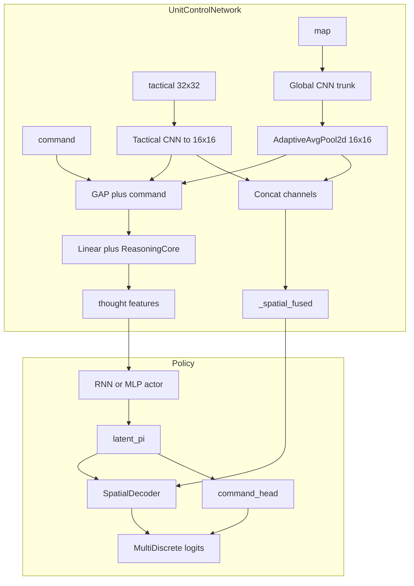

# StarCraft 2 Unit Control Agent

Reinforcement-learning project for **tactical unit control** in StarCraft II: curriculum-style Gymnasium environments, CNN-friendly observations, and **Maskable PPO** (including recurrent variants) via Stable-Baselines3 / sb3-contrib.

**Active development:** **Universal** training (`config_universal/`) and the **async universal** pipeline (`train/async_train_universal.py`), which decouples SC2 rollout collection from learning using a disk buffer. The **original** synchronous pipeline (`config/`, `train/train_pipeline.py`) is still in the tree for legacy levels (0–10, CTF, level drop) but is intended to be removed once the universal path fully replaces it.

> **For AI assistants:** Treat this README plus `src/utils/config_manager.py`, `train/envs/level_0_env.py`, `src/sc2_bot_universal.py`, and `src/utils/layer_constants.py` as the source of truth for observation/action wiring.

---

## Tech stack (short)

| Area | Choices |
|------|---------|
| Language | Python 3.10+ |
| Game API | burnysc2 (python-sc2 ecosystem) |
| RL API | Gymnasium |
| Algorithms | Maskable PPO, Maskable Recurrent PPO (custom), SB3 / sb3-contrib |
| Deep learning | PyTorch |
| Config | PyYAML (`*.yaml` per level + `pipeline.yaml`) |
| Logging / metrics | Loguru, TensorBoard |
| Tests | pytest |

---

## Repository layout (high level)

```
sc2_unit_agent/
├── config/                    # Original curriculum (legacy pipeline)
├── config_universal/          # Universal curriculum + agent_architecture: universal
├── train/
│   ├── train_pipeline.py      # Original multi-level training
│   ├── train_universal.py     # Synchronous universal training
│   ├── async_train_universal.py  # Async collector / learner (in development)
│   ├── envs/                  # Gym environments (Level0Env, CTF, drop, …)
│   └── maps/                  # Map assets per level
├── src/
│   ├── transformers/          # ObservationTransformer → tensor stacks
│   ├── agent/                 # PPO variants, policies, networks
│   ├── sc2_bot.py             # Original bot / action decoding
│   ├── sc2_bot_universal.py   # Universal MultiDiscrete decoding
│   └── utils/
│       ├── config_manager.py  # Curriculum merging (layers, heads)
│       └── layer_constants.py # Canonical observation layer names
├── train_original.bat         # Original pipeline
├── train_universal.bat        # Universal pipeline
└── train_async_universal.bat  # Async universal pipeline
```

---

## How to run training

From the repo root (Windows examples; set `PYTHONPATH` to the project root if needed):

| Goal | Command |
|------|---------|
| Original curriculum | `train_original.bat` or `python train/train_pipeline.py` |
| Universal curriculum | `train_universal.bat` or `python train/train_universal.py` |
| Async universal | `train_async_universal.bat` or `python train/async_train_universal.py` |

Universal training uses **`config_universal/`**, writes under `models_universal/` and `logs_universal/` by default. Async mode uses a temp buffer directory (see `TEMP_DIR` in `async_train_universal.py`).

**StarCraft II** must be installed; map paths are resolved from `train/maps/` and from `env.maps_dir` in each level YAML.

---

## Configuration: two trees

- **`config/`** — Original pipeline: long level list in `config/pipeline.yaml` (level_0 … CTF … level_drop_*, etc.). Implies **`agent_architecture`** default **`original`** when not set.
- **`config_universal/`** — Shorter universal curriculum; `config_universal/pipeline.yaml` sets `agent_architecture: universal` and lists `level_move_*` stages.

Each **level file** (e.g. `level_0.yaml`, `level_move_single_0.yaml`) typically contains:

- **`training`** — steps, vec env count, PPO hyperparameters, watchdog, etc. Optional **`tensorboard_subdir`**: subdirectory under `logs_universal/<level>/` for TensorBoard and CSV (async defaults to `"async"`; set e.g. `async_spatial16` for a new experiment so prior runs stay separate).
- **`env`** — `grid_size`, `max_steps`, `maps_dir`, rewards, and the additive lists below.
- **`model`** — policy class kwargs, `features_extractor_class`, algorithm choice.

### Universal policy (spatial fusion + decoder)

For `agent_architecture: universal`, `UnitControlNetwork` keeps **global** and **tactical** CNN features at **16×16**, concatenates them into `_spatial_fused`, and uses global-average-pooled vectors plus `command` for the reasoning trunk. `UniversalRecurrentPolicy` / `UniversalActorCriticPolicy` split the actor head into **`command_head`** (verb logits) and **`SpatialDecoder`** (32×32 spatial logits from fused maps + GRU/MLP latent), instead of a single large linear over 1024 cells.



Environments receive a merged **`training_conf`** dict: `Level0Env` flattens `training` and `env` sections into `training_conf` so bots and `ObservationTransformer` see a single flat config.

---

## `ConfigManager` — behavior (read this before changing obs/action code)

**Module:** `src/utils/config_manager.py`

**Constructor:** `ConfigManager(config_dir: str = "config")`  
Loads `<config_dir>/pipeline.yaml` once. All other reads are `<config_dir>/<level_name>.yaml`.

### `pipeline.yaml` fields used

- **`levels`** — Ordered curriculum. Used to define **accumulation order** for additive properties.
- **`agent_architecture`** (optional) — Returned by `get_agent_architecture()`. Default if missing: **`"original"`**.
- **`active_layers`**, **`active_tactical_layers`**, **`action_heads`**, **`categorical_heads`** (optional at **pipeline root**) — Seed lists applied **before** any level file is processed (same additive rules as per-level).

### Additive (cumulative) getters

For a target level name `L`, each of these methods:

1. Starts from the **pipeline root** list for that property (if present).
2. Walks **`pipeline.yaml`’s `levels` in order**, loading each `level.yaml`’s `env` section.
3. For each level, if `env.<property>` is non-empty, **appends** new items **in order**, **skipping duplicates** (case-insensitive).
4. **Stops** when the walk reaches `L`.
5. **If `L` is not in `pipeline.levels`**, it still loads `L.yaml` and merges `env.<property>` from that file on top of everything accumulated so far (so “off-pipeline” levels still inherit the full chain — see tests in `tests/test_additive_config.py`).

| Method | YAML sources (under `env` unless noted) |
|--------|----------------------------------------|
| `get_cumulative_active_layers(level)` | `active_layers` |
| `get_cumulative_active_tactical_layers(level)` | `active_tactical_layers` |
| `get_cumulative_action_heads(level)` | `action_heads` |
| `get_cumulative_categorical_heads(level)` | `categorical_heads` |

**Important:** Lists are **union-in-order**, not per-level replacement. Adding a head or layer in a later level **never removes** earlier ones.

### Other methods

- `get_level_config(level_name)` — Raw dict from `<level_name>.yaml` (not merged with other levels).
- `get_agent_architecture()` — `pipeline.yaml` key `agent_architecture`, default `"original"`.

### Where it’s consumed

- **`train/envs/level_0_env.py`** (shared base for many levels): instantiates `ConfigManager(training_conf["config_dir"])`, sets `active_layers`, `active_tactical_layers`, `action_heads`, `categorical_heads`, `agent_architecture`, then copies lists into `training_conf` for the bot/transformer.

---

## Observations: channels and “input layers”

Observations use a **large, named channel set** defined by string IDs (e.g. `allied_unit_density`, `terrain_pathable`, DPS heatmaps, command channels, transport channels)—not a single fixed small stack of generic “heatmap” layers.

- **Canonical names and grouping:** `src/utils/layer_constants.py` (`LayerConstants`). Comments there describe normalization (e.g. log1p counts, tanh for DPS).
- **Which channels are enabled:** `env.active_layers` in each level YAML, **after cumulative merging** via `ConfigManager.get_cumulative_active_layers`.
- **Observation space (`Level0Env`):**
  - Always a **`gymnasium.spaces.Dict`**:
    - **`map`**: `(num_channels, 128, 128)` float32 in **[0, 1]**, where `num_channels == len(active_layers)` (or full stack size if layers list empty — see env code).
    - **`command`**: fixed low-dimensional vector (shape `(10,)`).
  - **Universal only:** extra key **`tactical`**: `(n_tactical, 32, 32)` where `n_tactical` comes from **cumulative** `active_tactical_layers` (defaults to mirroring `active_layers` if unset).

The **`ObservationTransformer`** builds tensors from the active layer name list; if you add a new layer name, you must implement it in the transformer and add a constant if you want a stable identifier.

---

## Actions: heads, shared spatial index, and categoricals

This is the area that most often confuses agents — **original** and **universal** differ.

### Original architecture (`agent_architecture != "universal"`)

- **Space:** `gymnasium.spaces.Discrete(N)` where  
  `N = len(action_heads) * grid_size^2 + len(categorical_heads)`.
- **Semantics:** Flattened `(head, y, x)` (plus categorical indices appended at the end of the integer range). Used with **`src/sc2_bot.py`** / level-specific bots.

### Universal architecture (`agent_architecture == "universal"`)

- **Space:** `gymnasium.spaces.MultiDiscrete([n_heads, spatial_res^2])` with **`spatial_res = 32`** (independent of `grid_size` in YAML for this product of spatial logits).
- **Semantics:** `action[0]` selects **command/head index**; `action[1]` selects a **single shared** 32×32 spatial cell used by that head (move global/local, attack, load, unload spatial, etc., depending on configured `action_heads`).
- **Bot:** `src/sc2_bot_universal.py` — maps `head_idx` to a head name, then interprets `spatial_idx` via the hierarchical/unit agent coordinate conversion. **Categorical** actions are represented by **extra head indices** after spatial heads: if `head_idx >= len(action_heads)`, the bot indexes `categorical_heads` (e.g. categorical `unload`).
- **Policy note:** `UniversalRecurrentPolicy` **disables masking on the spatial slice** of action masks (shared spatial head assumption). See `_disable_spatial_mask` in `src/agent/models/universal_recurrent_policy.py`.

### `action_heads` vs `categorical_heads`

- **`action_heads`** — Ordered list of **named** spatial heads (e.g. `move`, `attack`, `move_global`, `move_local`, `load`, `unload`). Cumulative via `ConfigManager`.
- **`categorical_heads`** — Small discrete “buttons” (no spatial target). In **original** mode they extend the flat `Discrete` space. In **universal** mode they occupy **additional command indices** after spatial heads in the MultiDiscrete first dimension.

When adding a capability, decide whether it needs a **grid target** (spatial head) or a **single toggle** (categorical), then extend the YAML and bot decoding consistently.

---

## Policies and feature extraction

- **Shared CNN / feature extractor:** commonly `src/agent/models/unit_control_network.py` (`UnitControlNetwork`), referenced from level YAML `model.policy_kwargs`.
- **Universal policies:** `src/agent/models/universal_policy.py`, `universal_recurrent_policy.py` — adapt SB3 actor heads to **MultiDiscrete** and recurrent state.

---

## Testing

```bash
pytest
```

Notable tests: `tests/test_additive_config.py` (ConfigManager accumulation), action mask / shape tests under `tests/`.

---

## Demo / debug UI

If present, `main.py --demo` and `run_demo.bat` exercise the observation / UI path; the primary training workflow is the `train/` pipelines above.

---

## License

See [LICENSE](LICENSE) (MIT if unchanged).

## Acknowledgments

- Blizzard Entertainment — StarCraft II
- SC2 API / python-sc2 community
- Stable-Baselines3, Gymnasium, PyTorch contributors
