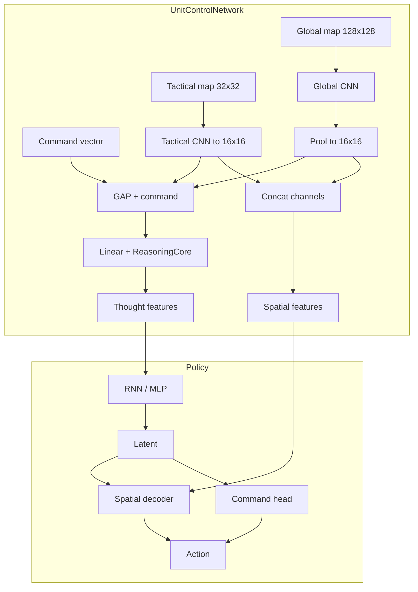
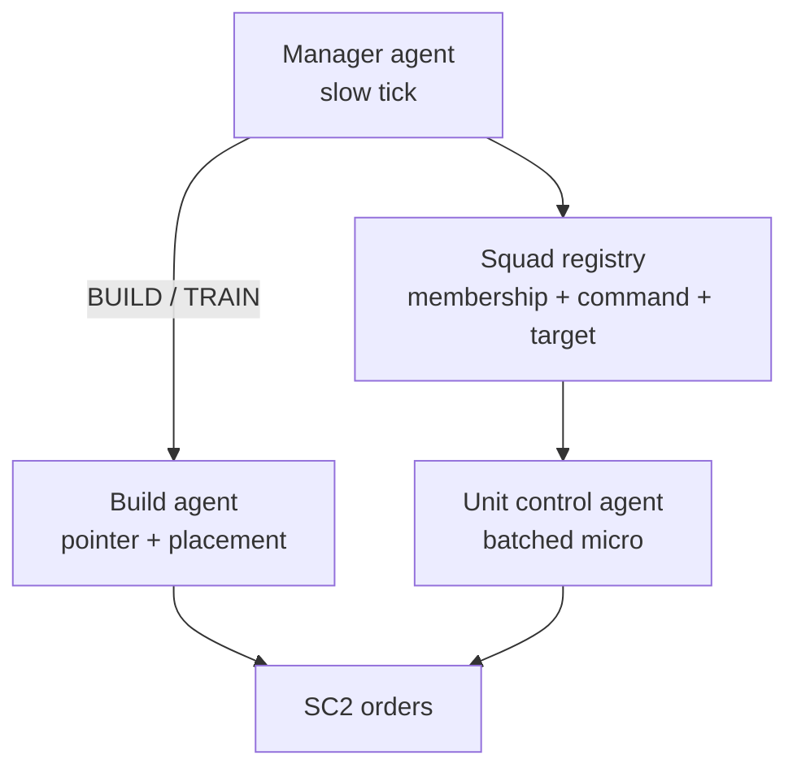

# StarCraft 2 Unit Control Agent

Reinforcement-learning project for **tactical unit control** in StarCraft II: curriculum-style Gymnasium environments, CNN-friendly observations, and **Maskable PPO** (including recurrent variants) via Stable-Baselines3 / sb3-contrib.

**Active development:** **Universal** training (`config_universal/`) and the **async universal** pipeline (`train/async_train_universal.py`), which decouples SC2 rollout collection from learning (disk memmap or shared-RAM buffers). The **original** synchronous pipeline (`config/`, `train/train_pipeline.py`) is still in the tree for legacy levels (including level drop) but is intended to be removed once the universal path fully replaces it.

> **For AI assistants:** See [AGENTS.md](AGENTS.md) for internal wiring rules, observation contracts, and implementation details.

**Development philosophy:** educational, well-commented RL code; **test-driven** changes for game logic and obs/action contracts; **modular** separation between SC2 bots, transformers, envs, and training; prefer minimal diffs on shared base classes (see [AGENTS.md](AGENTS.md)).

---

## Tech stack

| Area | Choices |
|------|---------|
| Language | Python 3.10+ |
| Game API | burnysc2 (python-sc2 ecosystem) |
| RL API | Gymnasium |
| Algorithms | Maskable PPO, Maskable Recurrent PPO (custom), SB3 / sb3-contrib |
| Deep learning | PyTorch |
| Config | PyYAML (`*.yaml` per level + `pipeline.yaml`) |
| Logging / metrics | Loguru, TensorBoard |
| Tests | pytest |

---

## Repository layout

```
sc2_unit_agent/
├── config/                    # Original curriculum (legacy pipeline)
├── config_universal/          # Universal curriculum + agent_architecture: universal
├── train/
│   ├── train_pipeline.py      # Original multi-level training
│   ├── train_universal.py     # Synchronous universal training
│   ├── async_train_universal.py  # Async collector / learner (in development)
│   ├── envs/                  # Gym environments (Level0Env, Level3Env, Level7Env, …)
│   └── maps/                  # Map assets per level
├── src/
│   ├── transformers/          # ObservationTransformer → tensor stacks
│   ├── agent/                 # PPO variants, policies, networks
│   ├── sc2_bot.py             # Original bot / action decoding
│   ├── sc2_bot_universal.py   # Universal MultiDiscrete decoding
│   └── utils/
│       ├── config_manager.py  # Curriculum merging (layers, heads)
│       └── layer_constants.py # Canonical observation layer names
├── train_original.bat         # Original pipeline
├── train_universal.bat        # Universal pipeline
└── train_async_universal.bat  # Async universal pipeline
```

---

## How to run training

**Prerequisites:** StarCraft II must be installed. Map files are expected under `train/maps/`.

From the repo root (Windows):

| Goal | Command |
|------|---------|
| Original curriculum | `train_original.bat` or `python train/train_pipeline.py` |
| Universal curriculum | `train_universal.bat` or `python train/train_universal.py` |
| Async universal | `train_async_universal.bat` or `python train/async_train_universal.py` |

Universal training uses `config_universal/`, writes models to `models_universal/` and logs to `logs_universal/`. Async mode uses a temp buffer directory (see `TEMP_DIR` in `async_train_universal.py`). CTF levels default to a shared-RAM rollout buffer; other levels default to disk memmap unless overridden.

---

## Curriculum design

Training progresses through a sequence of levels defined in `pipeline.yaml`. Each level introduces increasing complexity:

| Phase | Levels | What the agent learns |
|-------|--------|----------------------|
| Single-unit movement | `level_move_single_0` – `level_move_single_2` | Navigate one unit to a beacon on progressively harder maps |
| Multi-unit movement | `level_move_multi_0` – `level_move_multi_4` | Coordinate multiple units to their assigned beacons |
| Combat | `level_attack_0` – `level_attack_5` | Attack micro — kiting, focus fire, multi-unit fights |
| Capture the Flag | `ctf_level_01` … + scenarios / AoE | Squad architecture: AlphaStar-style command→actors→unit-target/spatial; phase-1 actions then phase-2 detailed layers; economic role rewards |

Capabilities are **additive** across the curriculum. Observation layers, action heads, and tactical layers accumulate: each level can add new ones, but never removes what earlier levels defined. This lets the network retain learned features as new capabilities are introduced.

**Universal masking:** how the flat `action_masks` vector lines up with `MultiDiscrete`, why spatial logits are not masked at the policy, Level 7 attack-in-fovea command masking, and why bots must use **cumulative** `training_conf['action_heads']` — see **Universal action masking** in [AGENTS.md](AGENTS.md).

---

## Configuration

Two config trees exist:

- **`config/`** — Original pipeline (legacy). `agent_architecture` defaults to `"original"`.
- **`config_universal/`** — Universal curriculum. Sets `agent_architecture: universal`.

Each level YAML file has three sections:

- **`training`** — step budget, PPO hyperparameters, vec env count, watchdog timeout
- **`env`** — environment class, targets, rewards, observation layers, action heads
- **`model`** — algorithm, policy class, network architecture kwargs

The **ConfigManager** (`src/utils/config_manager.py`) merges configs cumulatively across levels. See [AGENTS.md](AGENTS.md) for the detailed accumulation rules.

---

## Architecture overview

### Universal policy (spatial fusion + decoder)

The universal architecture uses two parallel CNN streams:

1. **Global CNN** — processes a 128×128 map with all active observation layers
2. **Tactical CNN** — processes a 32×32 crop centered on the active unit

Both are downsampled to 16×16, concatenated, and fused. A reasoning core produces features for the policy, which outputs:

- **Command head** — which action type to perform (move, attack, etc.)
- **Spatial decoder** — where on the 32×32 grid to target



### CTF squad policy (`agent_architecture: squad`)

CTF / scenario / AoE levels use a **squad** policy grafted from the last attack checkpoint. Sampling is AlphaStar-style **command → actors → terminal target or spatial cell**:

- **`attack_unit` / `heal_unit` / `load_unit`** name a unit by tag (terminal target slot); spatial click-heals and click-loads (`heal_local`, `load_local`, `heal_click_cells`) are gone. Unload stays spatial (`unload_local`).
- Spatial heads (`move_*`, `attack_local`, `aoe_local`, load/unload) still decode a world cell.
- The curriculum is **two-phase**: phase 1 teaches those actions on the base attack-5 observation stack; phase 2 adds detailed map overlays. Combat reward is **economic** (resource-weighted, role-asymmetric) — see **CTF squad pointer architecture** in [AGENTS.md](AGENTS.md).

---

## Observations

The agent sees the game through **named observation channels** — density maps, health, DPS heatmaps, terrain, command assignments, etc. All channel names and indices are defined in `src/utils/layer_constants.py`.

Each level YAML specifies which channels to activate. Channels accumulate across levels and are always presented in a stable order (see [AGENTS.md](AGENTS.md) for the ordering contract).

Observations are `float32` in `[0, 1]` from `ObservationTransformer`; training uses `normalize_images=False` so SB3 does not re-normalize.

---

## Testing

```bash
pytest
```

Notable tests: `tests/test_additive_config.py` (config accumulation), action mask / shape tests under `tests/`, plus `tests/test_sc2bot_action_heads_flattened_priority.py` and `tests/test_level_7_tactical_attack_mask.py` for universal masking contracts.

---

## Demo / debug UI

`run_game_with_ui.py` (or `run_demo.bat`) runs the PyQt5 debug UI with the observation path; the primary training workflow is the `train/` pipelines above.

---

## Future path

Long-range product direction for a **fully learned** SC2 AI Arena bot (no scripted macro/micro). Wiring contracts for code that exists today are in [AGENTS.md](AGENTS.md); this section is the human-oriented roadmap.

### Target: hierarchical all-AI ladder bot

Three learned layers, top-down:

1. **Manager agent** — slow tick (e.g. every 8–16+ game steps); creates/updates squads; sets `high_level_command`, coarse target, and unit membership (pointer-based **multi-select**).
2. **Build agent** — runs only on `BUILD` / `TRAIN` / `EXPAND`; **softmax pointer** picks one worker; spatial head picks valid placement (walling, distance).
3. **Unit control agent** — the universal spatial policy trained now (`UnitControlNetwork` + `MaskableRecurrentPPO`); per-unit micro reads squad directive + objective from a **squad registry**.



**Command protocol:** manager emits a command object `{type, target_pos, unit_type, priority}` plus unit tags → updates global assignment → build path dispatches one worker to `BuildNetwork`; combat path groups units by squad/command and runs batched unit-control inference on **active** groups only.

**Worker routing:** `WorkerRegistry` assigns each worker to `mining`, `build`, or `micro`. Manager owns assignments; workers can be reassigned to `micro` for defense (e.g. all-in). `MiningController` (scripted first, learned later) handles `mining` workers every game step.

**Build training stack:** separate tree `config_build_zerg/`, `models_build_zerg/`, `train/train_build.py` (and `train/async_train_build.py` entry). MaskablePPO + `BuildNetwork`; action masks default to all-`True`.

**Scaling many squads:** training **multiplexes** squads over time (CTF round-robin); Arena **deploy** batches all hot squads each game step. Cold squads keep last orders. Workers route to the build agent, not unit micro.

### Already implemented (foundation)

| Concept | Where it lives | Role in future stack |
|--------|----------------|----------------------|
| Universal micro policy | `src/agent/models/unit_control_network.py`, `config_universal/level_attack_*` | Unit control agent |
| `high_level_command` + `command_target` | `CommandConstants`, `ObservationTransformer`, bots | Manager → micro context |
| Per-unit maps (CTF) | `CaptureTheFlagBot.unit_command_map`, `unit_target_map`; `unit_pool_index`, `squad_unit_tags` | Prototype squad registry (YAML/spawn today → manager later) |
| Squad batch inference | `train/squad_batch_inference.py` | One GPU forward per squad; extend to multi-squad deploy |
| Build network scaffold | `src/agent/models/build_network.py`, `EntityEncoder`, `PointerAttention` | Build agent (**not** in training loop yet) |
| Reasoning core | `src/models/components/reasoning_core.py` | Shared multi-step “thinking” for all three nets |
| Self-play snapshots | CTF `every_k_episodes`, frozen opponent model | League of past checkpoints |
| Additive curriculum | `ConfigManager`, `config_universal/pipeline.yaml` | micro → CTF → future build/manager levels |
| Alternate CTF package | `train/envs/ctf/` (`CTFEnv`, `SquadManager`) | Experiment path; production uses `CaptureTheFlagSingleEnv` |

### Planned networks (not built yet)

**Manager (design):** global resource/army vector + minimap CNN; `ReasoningCore`; heads for command type, build/train parameter, coarse 16×16 sector, and **sigmoid** unit drafting (independent per-unit scores, threshold → squad). Recurrent for long-horizon planning. **Not implemented.**

**Build (scaffold only):** `BuildNetwork` — worker `EntityEncoder`, command embedding, local terrain CNN, `PointerAttention` (one worker), placement head over local grid. Fixed reasoning depth (~3 steps). **No Gym level / PPO wiring yet.**

**Unit control (today):** shared **32×32** spatial decoder + 64-way command head; `thinking_steps` in policy kwargs; hybrid spatial + categorical commands (see below).

### Asymmetric self-play (CTF)

- Trainee learns; opponent uses a **frozen checkpoint** (synced every `every_k_episodes` across envs).
- Trainee-centric termination when trainee army is eliminated; game can continue after opponent wipe for secondary objectives.
- Single-client `CaptureTheFlagSingleEnv` (not dual-process `CaptureTheFlagEnv`).

### Hybrid action heads (implemented)

Spatial targeting and non-spatial toggles are both supported; they are wired differently per architecture:

**Universal (`agent_architecture: universal`)** — action space is always `MultiDiscrete([64, 32×32])`:

- **`action_heads`** — spatial commands (move, attack, load, …): command index selects the head; spatial index selects the 32×32 cell (`SC2BotUniversal.apply_action`).
- **`categorical_heads`** — toggle commands (no spatial target): appended after spatial heads in `build_action_head_manifest` (`src/agent/universal_constants.py`); same 64-way command softmax selects them; bots actuate without using the spatial coordinate.
- Unused manifest slots are padded with `_unused` and masked off.
- Accumulated cumulatively via `ConfigManager.get_cumulative_categorical_heads`.
- Tests: `tests/test_universal_fixed_command_mask_tail.py`, `tests/test_sc2_bot_universal.py`.

**Original (legacy)** — flat `Discrete(N_spatial × grid² + N_categorical)`; categoricals are indices after all spatial cells.

**In use today:** legacy **level drop** (`config/level_drop_0.yaml`) — `load` spatial + `unload` categorical. Masking and unload actuation are implemented (`tests/test_unload_masking.py`, `tests/test_hybrid_masking.py`).

**Not yet on the universal curriculum:** no `categorical_heads` entries in `config_universal/` YAMLs yet (move/attack only). Adding race abilities (Stim, Siege, Burrow, Chrono, …) is a matter of new head names in level YAML + bot `apply_action` branches, not new action-space machinery.

### Legacy pipeline (`config/`) — optional vertical slices

Not on the universal curriculum path; kept for transport/multi-race experiments:

| Feature | Location | Notes |
|---------|----------|--------|
| **Level drop** (medivac lift) | `LevelDropEnv`, `config/level_drop_*.yaml` | Load → move → unload across void; fog; `transport_slots` / `passenger_density` layers |
| **Air units** | Original bots / masking | Flyers: unrestricted move/attack masks over pathing |
| **Load / unload** | `Level7Bot`, level drop | Race-specific `LOAD` abilities; unload mask with terrain erosion + building footprints |
| **Transport rewards** | Level drop bots | Scaled load/unload by cargo; emergency pickup below 50% HP; once-per-episode load credit |
| **Imitation learning** | Workstation / replay tooling | Human demos decomposed to per-unit examples; optional hybrid BC → RL |

These may be ported into `config_universal/` later or replaced by build/manager levels.

### Architecture decisions (superseded older plans)

| Older idea | Current approach |
|------------|------------------|
| 128×128 per-head spatial grids | Shared **32×32** spatial decoder on universal policy |
| One micro forward per squad per step | Squad **batch** inference; **round-robin** in training; **filter + batch** many squads at deploy |
| Heuristic manager “thinking depth” | All-AI stack: fixed or learned depth, not game-state scripts |
| Dual-client CTF self-play | Single-client + frozen opponent zip |
| Disk-only async buffer | CTF → shared RAM by default (`rollout_buffer_factory`) |
| LoRA + RAG “supervisor” league bot | Far-future research; not on near-term roadmap |

### Recommended implementation order

1. Finish universal micro + CTF (current).
2. Stabilize **SquadRegistry** API (generalize CTF maps; micro read path unchanged).
3. Build-agent Gym level + train `BuildNetwork` (fixed manager commands in env).
4. Manager-agent level with frozen unit control (+ build), then optional finetune.
5. Arena deploy wrapper: manager tick + build routing + batched micro on engaged squads.
6. Optional: hybrid categoricals, league checkpoints, converge `ctf_sc2_v1` with production CTF.

When this section disagrees with [AGENTS.md](AGENTS.md) or the code, **AGENTS.md and the code win**.

---

## License

See [LICENSE](LICENSE) (MIT if unchanged).

## Acknowledgments

- Blizzard Entertainment — StarCraft II
- SC2 API / python-sc2 community
- Stable-Baselines3, Gymnasium, PyTorch contributors
