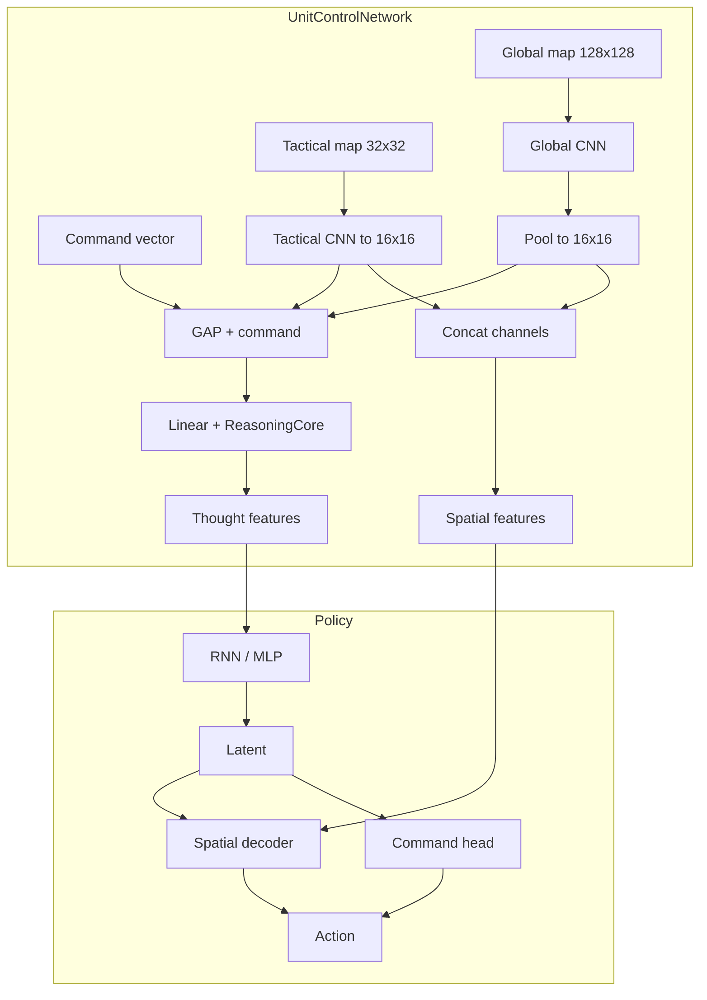

# StarCraft 2 Unit Control Agent

Reinforcement-learning project for **tactical unit control** in StarCraft II: curriculum-style Gymnasium environments, CNN-friendly observations, and **Maskable PPO** (including recurrent variants) via Stable-Baselines3 / sb3-contrib.

**Active development:** **Universal** training (`config_universal/`) and the **async universal** pipeline (`train/async_train_universal.py`), which decouples SC2 rollout collection from learning using a disk buffer. The **original** synchronous pipeline (`config/`, `train/train_pipeline.py`) is still in the tree for legacy levels (0–10, CTF, level drop) but is intended to be removed once the universal path fully replaces it.

> **For AI assistants:** See [AGENTS.md](AGENTS.md) for internal wiring rules, observation contracts, and implementation details.

---

## Tech stack

| Area | Choices |
|------|---------|
| Language | Python 3.10+ |
| Game API | burnysc2 (python-sc2 ecosystem) |
| RL API | Gymnasium |
| Algorithms | Maskable PPO, Maskable Recurrent PPO (custom), SB3 / sb3-contrib |
| Deep learning | PyTorch |
| Config | PyYAML (`*.yaml` per level + `pipeline.yaml`) |
| Logging / metrics | Loguru, TensorBoard |
| Tests | pytest |

---

## Repository layout

```
sc2_unit_agent/
├── config/                    # Original curriculum (legacy pipeline)
├── config_universal/          # Universal curriculum + agent_architecture: universal
├── train/
│   ├── train_pipeline.py      # Original multi-level training
│   ├── train_universal.py     # Synchronous universal training
│   ├── async_train_universal.py  # Async collector / learner (in development)
│   ├── envs/                  # Gym environments (Level0Env, Level3Env, Level7Env, …)
│   └── maps/                  # Map assets per level
├── src/
│   ├── transformers/          # ObservationTransformer → tensor stacks
│   ├── agent/                 # PPO variants, policies, networks
│   ├── sc2_bot.py             # Original bot / action decoding
│   ├── sc2_bot_universal.py   # Universal MultiDiscrete decoding
│   └── utils/
│       ├── config_manager.py  # Curriculum merging (layers, heads)
│       └── layer_constants.py # Canonical observation layer names
├── train_original.bat         # Original pipeline
├── train_universal.bat        # Universal pipeline
└── train_async_universal.bat  # Async universal pipeline
```

---

## How to run training

**Prerequisites:** StarCraft II must be installed. Map files are expected under `train/maps/`.

From the repo root (Windows):

| Goal | Command |
|------|---------|
| Original curriculum | `train_original.bat` or `python train/train_pipeline.py` |
| Universal curriculum | `train_universal.bat` or `python train/train_universal.py` |
| Async universal | `train_async_universal.bat` or `python train/async_train_universal.py` |

Universal training uses `config_universal/`, writes models to `models_universal/` and logs to `logs_universal/`. Async mode uses a temp buffer directory (see `TEMP_DIR` in `async_train_universal.py`).

---

## Curriculum design

Training progresses through a sequence of levels defined in `pipeline.yaml`. Each level introduces increasing complexity:

| Phase | Levels | What the agent learns |
|-------|--------|----------------------|
| Single-unit movement | `level_move_single_0` – `level_move_single_2` | Navigate one unit to a beacon on progressively harder maps |
| Multi-unit movement | `level_move_multi_0` – `level_move_multi_4` | Coordinate multiple units to their assigned beacons |
| Combat | `level_attack_0` | Attack micro — engage enemy units |

Capabilities are **additive** across the curriculum. Observation layers, action heads, and tactical layers accumulate: each level can add new ones, but never removes what earlier levels defined. This lets the network retain learned features as new capabilities are introduced.

---

## Configuration

Two config trees exist:

- **`config/`** — Original pipeline (legacy). `agent_architecture` defaults to `"original"`.
- **`config_universal/`** — Universal curriculum. Sets `agent_architecture: universal`.

Each level YAML file has three sections:

- **`training`** — step budget, PPO hyperparameters, vec env count, watchdog timeout
- **`env`** — environment class, targets, rewards, observation layers, action heads
- **`model`** — algorithm, policy class, network architecture kwargs

The **ConfigManager** (`src/utils/config_manager.py`) merges configs cumulatively across levels. See [AGENTS.md](AGENTS.md) for the detailed accumulation rules.

---

## Architecture overview

### Universal policy (spatial fusion + decoder)

The universal architecture uses two parallel CNN streams:

1. **Global CNN** — processes a 128×128 map with all active observation layers
2. **Tactical CNN** — processes a 32×32 crop centered on the active unit

Both are downsampled to 16×16, concatenated, and fused. A reasoning core produces features for the policy, which outputs:

- **Command head** — which action type to perform (move, attack, etc.)
- **Spatial decoder** — where on the 32×32 grid to target



---

## Observations

The agent sees the game through **named observation channels** — density maps, health, DPS heatmaps, terrain, command assignments, etc. All channel names and indices are defined in `src/utils/layer_constants.py`.

Each level YAML specifies which channels to activate. Channels accumulate across levels and are always presented in a stable order (see [AGENTS.md](AGENTS.md) for the ordering contract).

---

## Testing

```bash
pytest
```

Notable tests: `tests/test_additive_config.py` (config accumulation), action mask / shape tests under `tests/`.

---

## Demo / debug UI

`run_game_with_ui.py` (or `run_demo.bat`) runs the PyQt5 debug UI with the observation path; the primary training workflow is the `train/` pipelines above.

---

## License

See [LICENSE](LICENSE) (MIT if unchanged).

## Acknowledgments

- Blizzard Entertainment — StarCraft II
- SC2 API / python-sc2 community
- Stable-Baselines3, Gymnasium, PyTorch contributors
